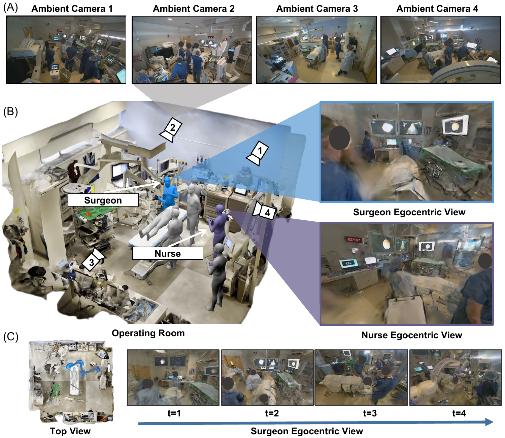
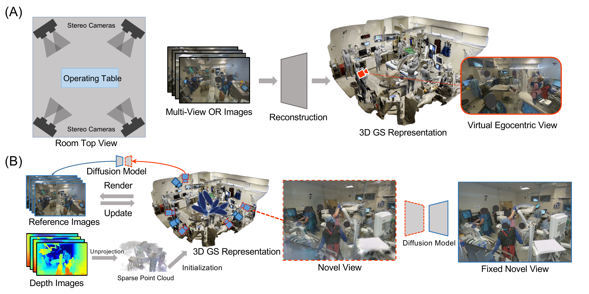

# EgoSurg

EgoSurg reconstructs dynamic operating rooms from sparse ambient camera views, enabling photorealistic replay from novel egocentric viewpoints.

[arXiv:2510.04802](https://arxiv.org/abs/2510.04802)





## Install

CUDA toolkit 11.8 and a current NVIDIA driver. The tested stack is Python 3.10 and PyTorch 2.7.1+cu118 on an RTX 4090 (24 GB).

```bash
conda env create -f environment.yml
conda activate egosurg
# fused-ssim imports torch while it builds, so it cannot sit in the
# environment.yml pip list. Install it only after torch is present.
pip install --no-build-isolation "git+https://github.com/rahul-goel/fused-ssim@328dc9836f513d00c4b5bc38fe30478b4435cbb5"
pip install -e .
bash scripts/setup_third_party.sh
export DIFIX3D_ROOT="$PWD/third_party/Difix3D"
export FOUNDATION_STEREO_ROOT="$PWD/third_party/FoundationStereo"
python scripts/download_weights.py
```

`gsplat==1.5.3` is installed from pip. The CUDA extension builds on first import. On this stack, FoundationStereo and Difix both run in the `egosurg` env. `scripts/export_stereo_depth.py` sets `TORCH_FORCE_NO_WEIGHTS_ONLY_LOAD=1` because PyTorch 2.6+ refuses the upstream checkpoint otherwise. `environment-stereo.yml` is a fallback that matches the upstream FoundationStereo pins (Python 3.11, torch 2.4.1) if that load still fails.

## Data format

One timestamp is one directory:

- `images/cam{i}_L.jpg` and `images/cam{i}_R.jpg`: rectified stereo pair.
- `depths/cam{i}_L.npy`: metric depth for the left camera. Right-camera `depth_path` may be `"None"`.
- `transforms.json`: pinhole frames with `file_path`, `depth_path`, `width`, `height`, row-major `K` (9 numbers), and `c2w` (4x4).
- `pov/extrinsics.txt`: one row-major 4x4 camera-to-world matrix for the handheld view.
- `pov/intrinsics.txt`: `fx fy cx cy`.
- `pov/pov.jpg` and `pov/visible_mask.png`: ground truth and the metric mask.

Right-eye names end in `_R` and are the held-out near-field views. See `demo/README.md`.

The demo and the paper runs are RGB-D. A COLMAP scene is optional and needs the parser pin from the gsplat examples, which is not installed by `environment.yml`. The `@cc7ea4b` suffix is pip syntax, not a GitHub path. The commit is [cc7ea4b](https://github.com/rmbrualla/pycolmap/commit/cc7ea4b7301720ac29287dbe450952511b32125e).

```bash
pip install "git+https://github.com/rmbrualla/pycolmap@cc7ea4b7301720ac29287dbe450952511b32125e"
```

Stereo depth for a new pair, using the upstream FoundationStereo demo:

```bash
python scripts/export_stereo_depth.py \
  --left assets/egosurg_demo/t001/images/cam0_L.jpg \
  --right assets/egosurg_demo/t001/images/cam0_R.jpg \
  --intrinsics cam0_K.txt
```

The left image has to be `{timestamp}/images/cam{i}_L.jpg`. The script writes `{timestamp}/depths/cam{i}_L.npy` and deletes `{timestamp}/pts_cleaned.ply` and `{timestamp}/depth_vals.npy` when those files exist, so the next training run rebuilds the point cloud from the new depth. Repeat for each left camera.

`cam0_K.txt` is two lines: nine row-major `K` values, then the stereo baseline in meters. The bundled scene does not include these files. Take `K` from the left camera in `transforms.json`, and the baseline from the distance between that camera and its right-eye `c2w` translation. The upstream demo also writes a preview and a point cloud, then opens a window until ESC. This wrapper discards those side files and skips the window.

## Demo

One timestamp is in the repository at `assets/egosurg_demo/t001`. Layout is in `demo/README.md`.

```bash
python scripts/train.py 3DGS_diffusion \
  --data-dir assets/egosurg_demo/t001 \
  --result-dir outputs/t001 \
  --max-steps 2000 \
  --save-steps 2000 \
  --opacity-reg 0.3 \
  --disable-viewer

CKPT=outputs/t001/ckpts/ckpt_1999_rank0.pt
read -r FX FY CX CY < assets/egosurg_demo/t001/pov/intrinsics.txt
mkdir -p outputs/t001/pov_render
python scripts/render_pov.py 3DGS_diffusion \
  --data-dir assets/egosurg_demo/t001 \
  --result-dir outputs/t001 \
  --ckpt "$CKPT" \
  --custom-render-single-path assets/egosurg_demo/t001/pov/extrinsics.txt \
  --custom-render-single-output-name outputs/t001/pov_render/pov.jpg \
  --pov-K "$FX" "$FY" "$CX" "$CY" \
  --scale-filter-threshold 1e12 \
  --camera-filter-distance 0.3 \
  --disable-viewer

python eval/pov_metrics.py \
  --eval-dir outputs/t001/pov_render \
  --ref assets/egosurg_demo/t001/pov/pov.jpg \
  --mask assets/egosurg_demo/t001/pov/visible_mask.png \
  --gaussian-weights \
  --save-csv outputs/t001_metrics.csv
```

That command is the training configuration recorded for the reported experiments: 2000 steps, diffusion refinement at step 500 (15 views inside 0.4 m, already the `3DGS_diffusion` preset), SSIM loss weight 0.2, and opacity regularization 0.3. The preset already uses those values; the flags above make the step count and the opacity weight explicit. One timestamp on a 24 GB GPU is a few minutes.

## Train and render

`scripts/train.py` configs: `3DGS_diffusion` (full method), `3DGS_rgpd` (no diffusion), `3DGS_random` (image-only initialization), `pointmap` (depth reprojection).

```bash
python scripts/train.py 3DGS_diffusion \
  --data-dir /path/to/timestamp \
  --result-dir outputs/run \
  --disable-viewer
```

## Evaluation

See `eval/README.md` for the metric definitions and the mapping onto the paper tables. `eval/reference/near_field.csv` is the per-reconstruction near-field table with site labels removed.

## License

Apache License 2.0 for EgoSurg code. Upstream NVIDIA and Stability AI terms still apply to a full run. See `LICENSE` and `NOTICE`.

## Citation

```bibtex
@article{zhang2025egosurg,
  title={EgoSurg: Arbitrary view synthesis for egocentric replay of operating room workflows from ambient cameras},
  author={Zhang, Han and Seenivasan, Lalithkumar and Porras, Jose L. and Soberanis-Mukul, Roger D. and Ding, Hao and Shu, Hongchao and Killeen, Benjamin D. and Ghosh, Ankita and Yarmus, Lonny and Jopling, Jeffrey K. and Ishii, Masaru and Argento, Angela C. and Unberath, Mathias},
  journal={arXiv preprint arXiv:2510.04802},
  year={2025}
}
```
